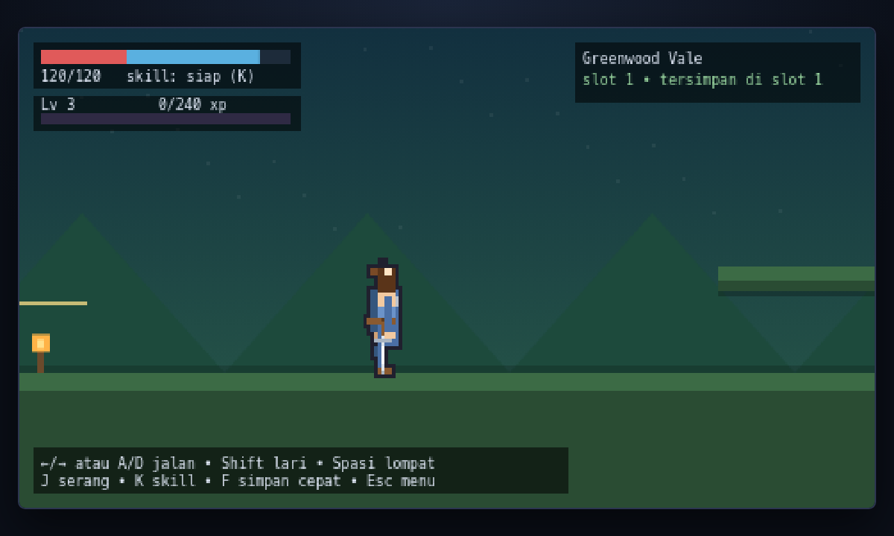
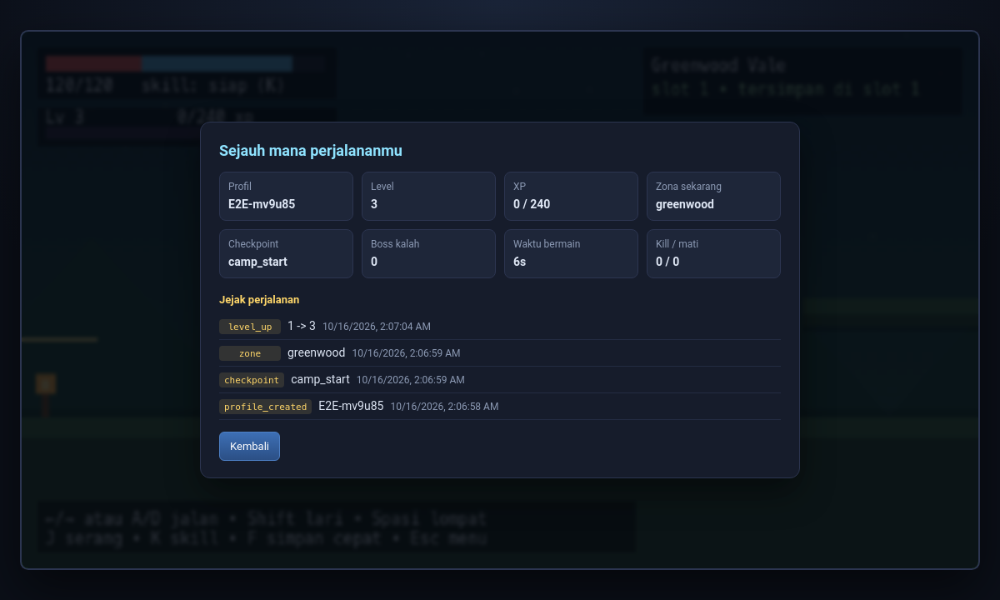
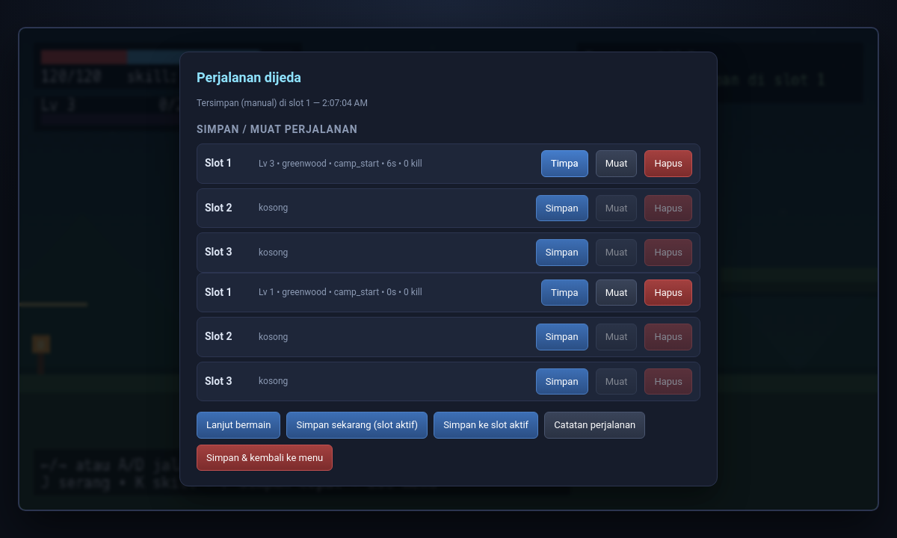

# Arga — Open World RPG Pixel Art (Medieval Fantasy · Side-view · Warrior)

Game RPG aksi side-view **solo** dengan karakter pixel art "Arga, Young Warrior Knight",
progres perjalanan yang bisa disimpan/dilanjutkan kapan saja, backend **C# (ASP.NET Core + SQLite)**,
dan klien game **HTML5 Canvas** (nol dependency, jalan langsung di browser).



## Jalankan

```bash
bash scripts/setup.sh     # sekali saja: SDK .NET lokal, Pillow, sprite, build server
bash scripts/dev.sh       # mulai game -> http://127.0.0.1:5080
```

`setup.sh` mengunduh SDK .NET 8 ke `./.dotnet` (project-local, tidak mengubah sistem),
meng-install Pillow, meng-generate 23 frame karakter, dan mem-build server.

| Kontrol | Aksi |
|---|---|
| `←` `→` / `A` `D` | jalan maju & mundur |
| `Shift` | berlari |
| `Spasi` / `W` / `↑` | lompat (crouch → naik → jatuh) |
| `J` / `Z` | serang pedang |
| `K` / `X` | skill **Aura Slash** (terbuka di level 3, butuh energi) |
| `F` | simpan cepat ke slot aktif |
| `Esc` | menu: simpan/muat slot, catatan perjalanan, keluar ke menu |

## Fitur

- **3 zona** (Greenwood Vale → Old Road → Reruntuhan Kuno), platform, gerbang antar zona,
  api unggun sebagai checkpoint, dan boss **Ruin Warden** di akhir.
- **Musuh dengan AI sendiri**: slime (patroli), kelelawar (mengejar dari udara),
  boss (charge + kontak damage). Kill memberi XP, naik level menambah HP maksimum &
  kekuatan serangan, dan membuka skill.
- **Progresi**: XP/level, energi skill, HP, waktu bermain, jumlah kill & kematian.
  Tumbang → respawn di checkpoint terakhir.
- **Save perjalanan**: 3 slot per profil, autosave tiap 30 detik + saat checkpoint/zona/boss,
  simpan & muat manual dari menu, plus simpan otomatis saat halaman ditutup.
  Mendarat kembali ke posisi, level, HP, dan zona terakhir.
- **Catatan perjalanan** (journey log): server mencatat otomatis tiap perubahan penting
  (level up, checkpoint, pindah zona, boss kalah) sehingga "sampai mana" bisa dilihat kapan saja.

| Catatan perjalanan | Simpan/muat slot |
|---|---|
|  |  |

## Struktur

```
assets/character/
  character.json                # palet + daftar 23 frame + animasi (fps/loop)
  reference/hero-reference.png  # render referensi 4x (background magenta)
  frames/*.png                  # 23 frame hasil generator prosedural
  generated/anchor.json         # titik kaki sprite (dipakai klien & tool)
  build/arga_spritesheet.png    # spritesheet + atlas JSON + .tres Godot 4
tools/
  generate_character_frames.py  # gambar karakter & animasinya (prosedural, konsisten)
  make_spritesheet.py           # rakit frame -> spritesheet + atlas + SpriteFrames
server/RpgServer/               # backend C#
  Program.cs                    # minimal API + static hosting (game + aset)
  GameDb.cs                     # SQLite: profil, slot save, catatan perjalanan
  StateValidator.cs             # validasi & normalisasi payload save
web/                            # klien game (HTML5 Canvas, tanpa bundler)
  index.html, style.css
  js/core.js                    # aturan game (murni, diuji headless)
  js/atlas.js                   # loader spritesheet + animator
  js/game.js                    # loop, render, HUD, menu, autosave
  js/api.js                     # klien REST ke backend
  test/                         # tes node: logika, kontrak API, browser headless
scripts/                        # setup.sh, dev.sh, test-all.sh
```

## Arsitektur

```
Browser (HTML5 Canvas)                 C# ASP.NET Core (1 proses)          SQLite
┌────────────────────────┐   REST     ┌───────────────────────────┐   ┌──────────────────┐
│ core.js  (aturan game) │ ─────────► │ /api/profiles             │   │ profiles         │
│ atlas.js (sprite)      │  save/load │ /api/profiles/{id}/slots  │──►│ save_slots       │
│ game.js  (render/HUD)  │            │ /api/profiles/{id}/journey│   │ events           │
└────────────────────────┘ ◄───────── │ static: /  /js  /assets   │   └──────────────────┘
                                       └───────────────────────────┘
```

- Server menyajikan game **dan** API dalam satu port, jadi tidak ada CORS/masalah origin.
- Progresi bersifat *client-authoritative* (game solo offline tanpa login); server tetap
  memvalidasi bentuk & batas nilai payload agar database sehat dan tidak bisa asal ditimpa.
- Semua frame sprite memakai region cell yang sama (`align: canvas`), jadi animasi tidak
  jitter walau pose berbeda.

### API

| Metode | Endpoint | Fungsi |
|---|---|---|
| `GET` | `/api/health` | status server + lokasi database |
| `GET` `POST` | `/api/profiles` | daftar / buat profil (nama 1-24 karakter) |
| `GET` `DELETE` | `/api/profiles/{id}` | detail / hapus profil |
| `GET` | `/api/profiles/{id}/resume` | lanjutkan dari slot terakhir |
| `GET` `PUT` `DELETE` | `/api/profiles/{id}/slots/{slot}` | muat / simpan / hapus slot (1-3) |
| `GET` | `/api/profiles/{id}/journey` | profil + slot + catatan perjalanan |
| `POST` | `/api/profiles/{id}/events` | catat event manual |

## Pengembangan

```bash
bash scripts/test-all.sh              # build C# + 18 tes logika + 10 tes API + tes persistensi
RUN_BROWSER=1 bash scripts/test-all.sh # + tes end-to-end di Chromium headless (butuh npm install di web/)

python3 tools/generate_character_frames.py   # gambar ulang 23 frame karakter
python3 tools/make_spritesheet.py            # rakit ulang spritesheet/atlas/.tres
python3 tools/make_spritesheet.py --target-height 64   # skalakan ke tinggi badan 64px
```

Tes browser headless menjalankan game sungguhan: buat profil lewat form, gerak/lari/lompat
(memastikan frame `jump_1/jump_2/jump_3` benar-benar tergambar), serang, cek skill terkunci di
level 1 lalu aktif di level 3, simpan lewat menu pause, verifikasi isi database lewat HTTP,
reload halaman, dan memastikan perjalanan lanjut dari titik tersimpan.

## Sprite & Godot 4

Pipeline frame → spritesheet tetap kompatibel dengan dokumen prompt:

1. `assets/character/character.json` menyimpan palet & daftar 23 frame.
2. `tools/generate_character_frames.py` menggambar tiap frame (idle, walk, run, jump, attack,
   skill, hurt, death) dari satu tabel pose + auto-plant kaki, jadi tinggi badan konsisten.
3. `tools/make_spritesheet.py` menghasilkan:
   - `arga_spritesheet.png` (PNG RGBA + atlas JSON)
   - `arga_frames.tres` — resource `SpriteFrames` Godot 4 siap dipakai `AnimatedSprite2D`
   - untuk menghadap kiri cukup `flip_h`, tidak perlu frame tambahan.
4. `PROMPTS.md` (dokumen 2 dari 3) tetap bisa dipakai untuk membuat variasi gaya AI;
   simpan hasilnya ke `assets/character/frames/` dengan nama yang sama lalu rakit ulang.
   Kalau frame hasil AI punya margin berbeda-beda, pakai `align: bottom-center` (default)
   alih-alih `canvas` di `character.json`.

## Catatan

- Tanpa autentikasi — dirancang untuk main solo di komputer sendiri (`RPG_HOST` untuk bind alamat lain).
- Database ada di `server/data/rpg.db` (ubah lewat env `RPG_DB`). Port lewat `RPG_PORT` / `--port`.
